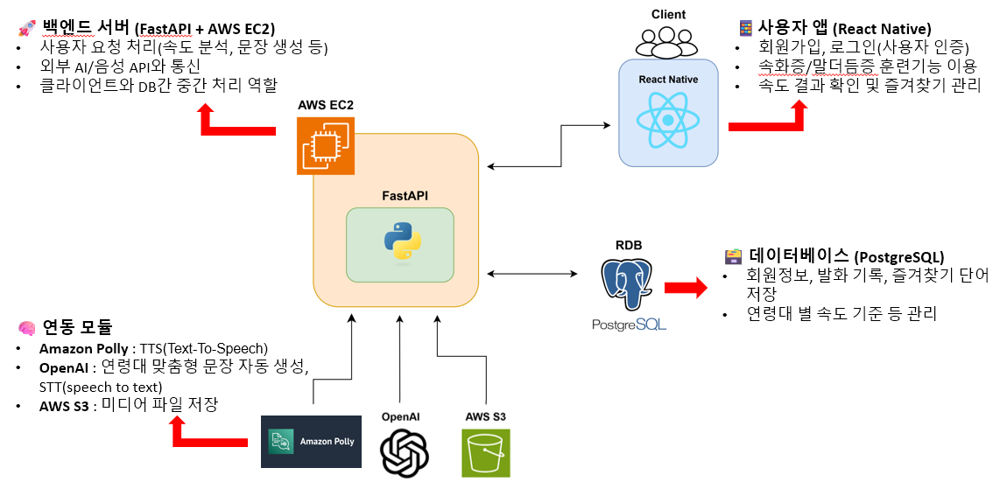

<div align="center">

# 🗣️ LeadMe

### AI 기반 모바일 언어치료 지원 시스템

**말더듬증·속화증 등 유창성 장애 사용자의  
지속적인 발화 훈련을 돕는 Android 애플리케이션**

<br/>


</div>

<br/>

## 💡 About LeadMe

언어치료는 꾸준한 반복 훈련이 중요하지만  
시간과 장소의 제약으로 지속적으로 관리하기 어렵습니다.

**LeadMe**는 이러한 문제를 해결하기 위해 개발한  
**유창성 장애 사용자를 위한 모바일 언어치료 지원 시스템**입니다.

사용자는 Android 모바일 환경에서 자신의 발화를 직접 녹음하고 분석하며,  
말더듬증과 속화증에 맞는 훈련을 반복적으로 수행할 수 있습니다.

또한 OpenAI와 음성 처리 기술을 활용하여  
사용자의 연령과 훈련 방식에 맞는 콘텐츠와 발화 피드백을 제공합니다.

<br/>

## 🎯 Target

LeadMe는 다음과 같은 사용자를 대상으로 합니다.

- 말더듬증 또는 속화증과 같은 **유창성 장애를 겪는 청소년 및 성인**
- 언어 치료가 필요한 **아동과 보호자**
- 사용자의 훈련을 보조하는 **언어치료 전문가**

<br/>

## ✨ Key Features

### 🗣️ 말더듬증 훈련

단어부터 문장까지 단계적으로 발화를 연습할 수 있습니다.

- 주제별 낱말 카드 학습
- 랜덤 / 단어 목록 / 즐겨찾기 기반 학습
- 선택한 단어와 연령을 기반으로 한 **AI 문장 생성**
- 녹음 및 발화 재생
- **DAF(Delayed Auditory Feedback)** 기반 발화 훈련
- Amazon Polly를 활용한 TTS 제공

<br/>

### ⏱️ 속화증 훈련

사용자의 발화 속도를 측정하고 적절한 속도로 말할 수 있도록 훈련합니다.

- 자유 발화 녹음
- **SPM(Syllables Per Minute)** 기반 발화 속도 분석
- 연령대별 기준과 비교한 속도 피드백
- 발화 결과 및 기록 저장
- 직접 발화 사전 체험

<br/>

### 🎤 문장 발화 훈련

일정한 발화 속도를 익힐 수 있도록  
문장을 시각적인 타이밍에 맞춰 읽는 훈련을 제공합니다.

- 연령대에 맞는 연습 문장 생성
- 빠름 / 조금 빠름 / 평균 / 느림 속도 선택
- **SPS(Syllables Per Second)** 기반 발화 타이밍 계산
- 음절 단위 **노래방 효과**
- 녹음 및 재생을 통한 자기 피드백
- TTS를 활용한 예시 음성 제공

<br/>

### 📊 음성 피로도 분석

1분 이상의 장시간 발화를 분석하여  
시간에 따른 발화 속도의 변화를 시각적으로 확인할 수 있습니다.

- 장시간 음성 데이터 분석
- 발화 구간별 SPM 측정
- **Hyperbolic Model** 기반 발화 속도 변화 분석
- 음성 피로도 결과 시각화

<br/>

### 🤖 AI & Speech

외부 AI 및 음성 API를 활용하여 훈련 콘텐츠를 제공합니다.

- **OpenAI Whisper** 기반 Speech-to-Text
- **OpenAI GPT** 기반 연령 맞춤형 문장 생성
- 생성 문장 내 부적절한 콘텐츠 검사 및 재생성
- **Amazon Polly** 기반 Text-to-Speech

<br/>

### 👤 사용자 관리

JWT 기반 사용자 인증과 개인별 훈련 기록을 관리합니다.

- 회원가입 / 로그인
- 아이디 및 비밀번호 찾기
- 회원정보 조회 및 수정
- 회원 탈퇴
- JWT 기반 인증
- 즐겨찾기 단어 관리
- 개인 발화 속도 기록 조회

<br/>

## 🔄 Training Flow

```text
Record
  ↓
Analyze
  ↓
Feedback
  ↓
Train
  ↓
Record
```

LeadMe는 단순히 훈련 콘텐츠를 보여주는 것이 아니라  
**사용자의 발화 → 분석 → 피드백 → 반복 훈련**으로 이어지는  
자가 훈련 환경을 제공하는 것을 목표로 합니다.

<br/>

## 🏗️ Architecture


<br/>

## 🛠 Tech Stack

| Category | Technology |
| --- | --- |
| **Mobile** | React Native, TypeScript |
| **Native** | Android Native Module |
| **Backend** | Python, FastAPI |
| **Database** | PostgreSQL, SQLAlchemy |
| **Authentication** | JWT |
| **AI** | OpenAI GPT |
| **STT** | OpenAI Whisper |
| **TTS** | Amazon Polly |
| **Audio Analysis** | Librosa, SciPy, PyDub |
| **Server** | AWS EC2 |
<br/>

## 🔍 Core Technologies

### DAF · Delayed Auditory Feedback

사용자의 음성을 입력받아 약 **200ms 지연 후 다시 출력**하여  
말더듬증 사용자의 발화 훈련을 돕습니다.

React Native에서 Android Native Module을 호출하고  
`AudioRecord`와 `AudioTrack`을 이용해 실시간 오디오 입출력을 처리합니다.

<br/>

### SPM · Syllables Per Minute

녹음된 사용자의 발화를 분석해  
분당 발화 음절 수를 계산합니다.

연령대별 발화 속도 기준과 비교하여  
현재 발화 속도에 대한 피드백을 제공합니다.

<br/>

### SPS · Syllables Per Second

문장을 읽을 때 초당 발화해야 하는 음절 수를 기준으로  
각 음절이 표시되는 간격을 계산합니다.

이를 화면의 **노래방 효과**와 결합하여  
사용자가 일정한 속도로 문장을 읽을 수 있도록 돕습니다.

<br/>

<div align="center">

### Speak at your own rhythm.

**LeadMe**

</div>